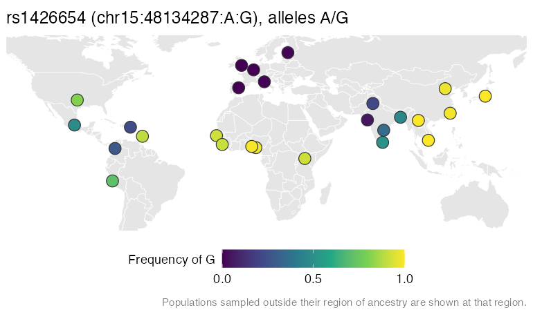
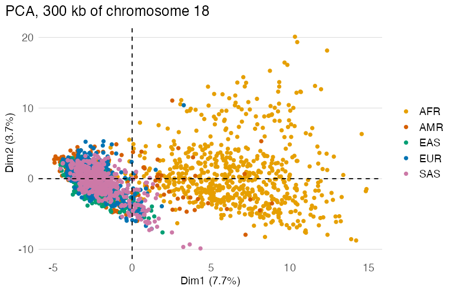
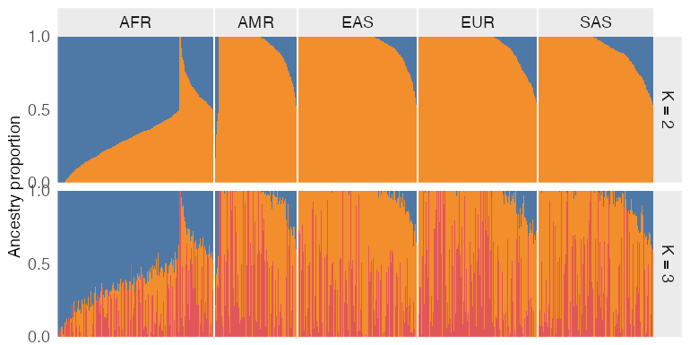
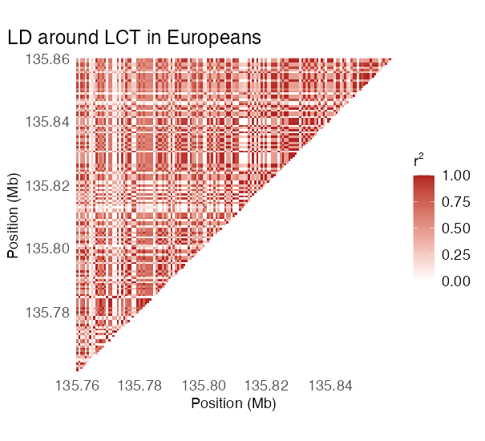

# snpscaper

<!-- badges: start -->
[](https://github.com/jarekbryk/snpscaper/actions/workflows/R-CMD-check.yaml)
<!-- badges: end -->

## Introduction

**snpscaper** is an R package for teaching human population genetics. It
lets students and staff explore how genetic variation is distributed within
and between human populations, using real genome data from the
[1000 Genomes Project](https://www.internationalgenome.org): 2,504 people
from 26 populations on five continents.

You name a gene (for example `"LCT"`) or a region of the genome, and
snpscaper fetches the genotypes directly from the 1000 Genomes server,
prepares them, and helps you analyse and plot them. **Everything happens
inside R**: there is no need for the command line, for separate
bioinformatics programs, or for downloading files by hand.

The package was designed for final-year undergraduate biology teaching, and
its documentation explains the concepts as well as the code. Note that snpscaper 
does not try to provide an accurate representation of genotypes in selected populations: 
our filtering of SNPs aims to avoid problems with downstream plots rather than carefully 
consider MAF or LD levels, for example. The point is to produce visualisations 
that highlight some opinionated features of human genetic diversity.

More information is available on the
[snpscaper website](https://jarekbryk.github.io/snpscaper/) and in the
vignettes.

## ⬇️ Installation

**snpscaper** is only available on GitHub. It depends on some packages
from [Bioconductor](https://bioconductor.org), which `pak` installs
automatically:

``` r
install.packages("pak")
pak::pak("jarekbryk/snpscaper")
```

PCA uses the FactoMineR and factoextra packages for PCA plots, and uses 
[Quarto](https://quarto.org) for the HTML reports (installed with recent versions of RStudio):

``` r
pak::pak(c("FactoMineR", "factoextra"))
```

## ⚙️ How it works

### Fetching data

`fetch_region()` downloads genotypes for one or more genes or regions of
the GRCh38 genome. It reads only the requested part of the 1000 Genomes
files, keeps biallelic SNPs, and records each person's genotype as 0, 1 or
2 copies of the alternative allele. Fetched regions are cached on disk, so
fetching them again is instant and works offline.

The package comes with a table of `teaching_genes` with well-known patterns
of variation (LCT, MC1R, SLC24A5, EDAR, ALDH2, ACKR1, HBB, CYP1A2, HTT),
their key SNPs (`teaching_snps`), and two example datasets (`example_lct`
and `example_neutral`) that work offline.

### Preparing data

`filter_snps()` removes rare SNPs and, optionally, SNPs in strong linkage
disequilibrium with their neighbours. `keep_pops()` chooses populations.
`summary()` shows every processing step.

### Analysing data

| Analysis | Functions |
|---|---|
| Principal component analysis | `as_pca_table()`, then `FactoMineR::PCA()` and `factoextra` |
| Admixture | `run_admixture()`, `get_ancestry()`, `plot_admixture()`, `plot_cross_entropy()` |
| Allele frequencies | `calc_allele_freqs()`, `plot_freqs()`, `map_freqs()` |
| Differentiation (Fst) | `calc_fst()`, `plot_fst()` |
| Diversity (heterozygosity) | `calc_heterozygosity()`, `plot_heterozygosity()` |
| Linkage disequilibrium | `calc_ld()`, `plot_ld()` |

All plots are ggplot2 objects with fixed, colour-blind-friendly population colours (`superpop_colours`,
`pop_colours`).

### Reports

`render_report()` produces a self-contained HTML handout for any gene or
region, with all of the analyses above, numbered figures and tables, a
methods section, and some notes on the expected
patterns.

## 👩🏽‍💻️ Example use

``` r
library(snpscaper)

# Fetch the lactase gene, remove rare SNPs, choose some populations
lct <- fetch_region("LCT") |>
  filter_snps(min_maf = 0.01) |>
  keep_pops(pop = c("YRI", "LWK", "GBR", "FIN", "CHB", "JPT", "GIH", "PEL"))

# Where is the lactase persistence allele common?
lct |>
  calc_allele_freqs() |>
  map_freqs(snp = "rs4988235")

# PCA with FactoMineR and factoextra
pca <- FactoMineR::PCA(as_pca_table(filter_snps(lct, prune_ld = TRUE)),
                       quali.sup = 1:3, graph = FALSE)
factoextra::fviz_pca_ind(pca, habillage = "super_pop",
                         palette = unname(superpop_colours), geom = "point")

# Admixture analysis
adm <- run_admixture(filter_snps(lct, prune_ld = TRUE), k = 2:4)
plot_admixture(adm, k = 2:4)

# A complete handout for a gene
render_report("SLC24A5")
```









## 📚 Data

Genotypes: 1000 Genomes Project high-coverage phased panel, GRCh38
([Byrska-Bishop et al. 2022, *Cell* 185: 3426-3440](https://www.sciencedirect.com/science/article/pii/S0092867422009825)), from the EBI FTP
server. Gene and SNP positions: [Ensembl](https://www.ensembl.org).

## 💪🏽 Acknowledgements

Admixture analysis uses the sNMF method of the
[LEA](https://bioconductor.org/packages/LEA/) package ([Frichot et al.
2014](https://academic.oup.com/genetics/article/196/4/973/5935614?login=true)). Data are read with
[VariantAnnotation](https://bioconductor.org/packages/VariantAnnotation/)
and [Rsamtools](https://bioconductor.org/packages/Rsamtools/). 

snpscaper was first proposed by me (JB) and was subsequently coded as a series of R notebooks by [Alex Marshall](https://github.com/amarshall1312/) 
for his [final year project in 2023](https://github.com/amarshall1312/PCA-and-Admixture-analysis-of-the-1000-Genomes-Project-using-an-R-based-approach).
Claude code refactored that code into a proper R package and, crucially, added an R-based way of fetching the data from 1kgp, 
as the original version relied on browser-based downloading of VCF files.
