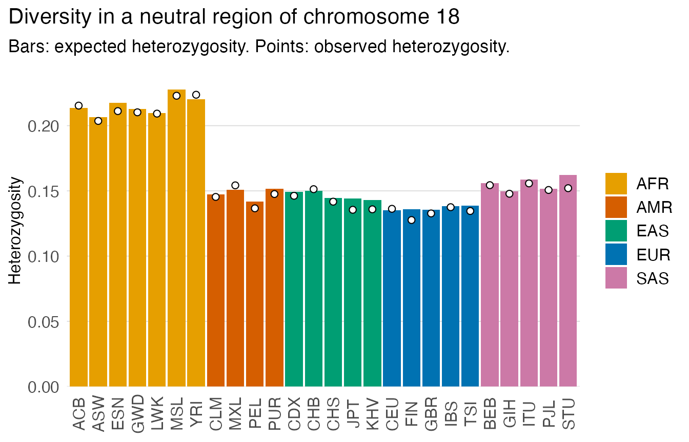
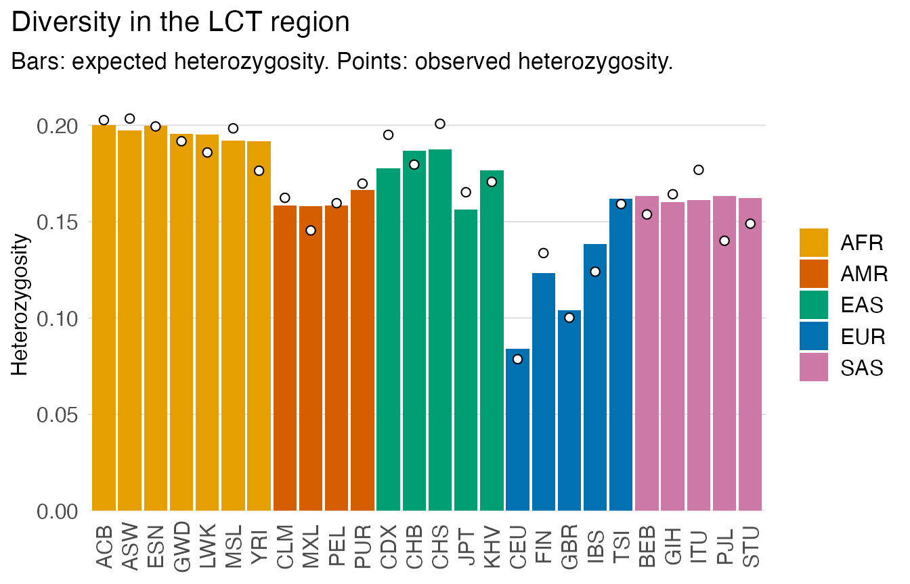
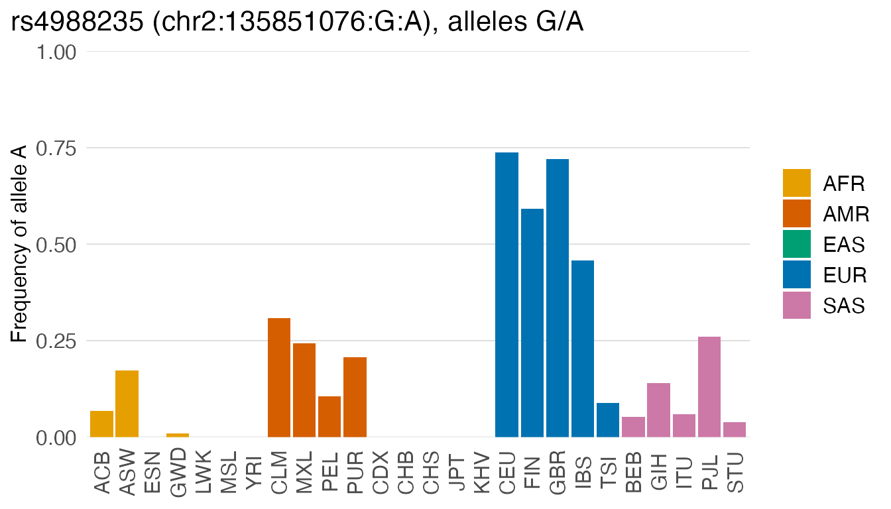
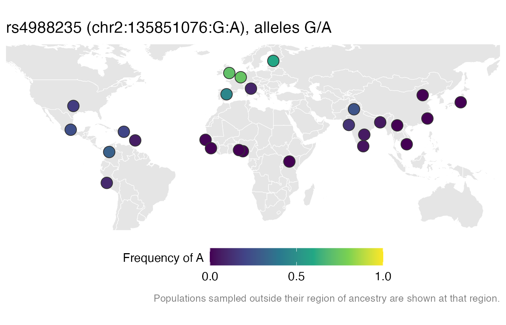
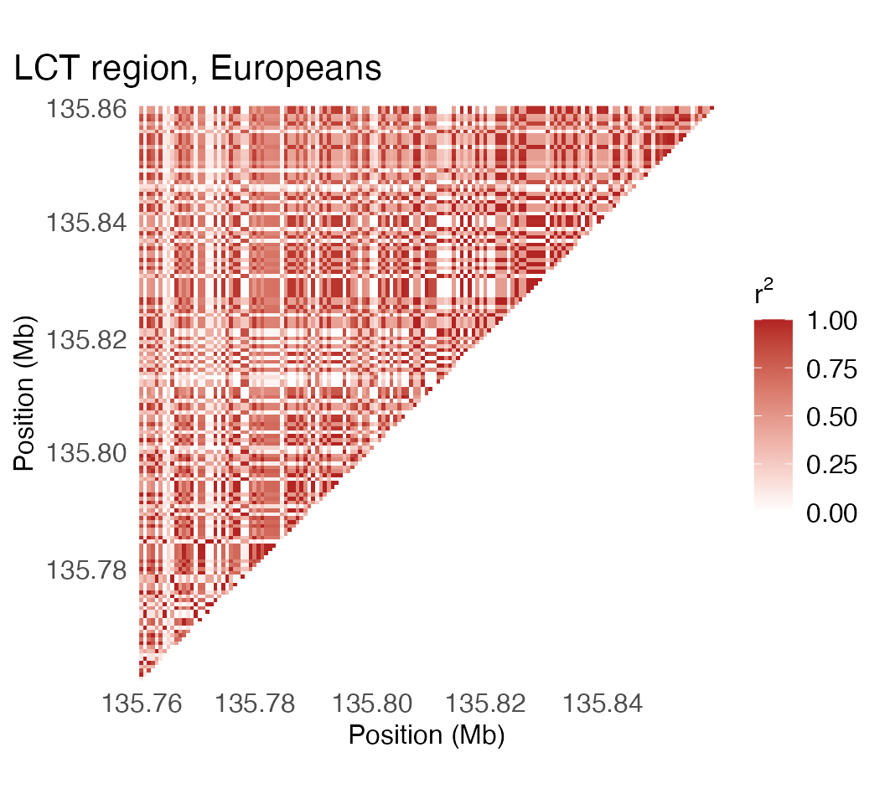
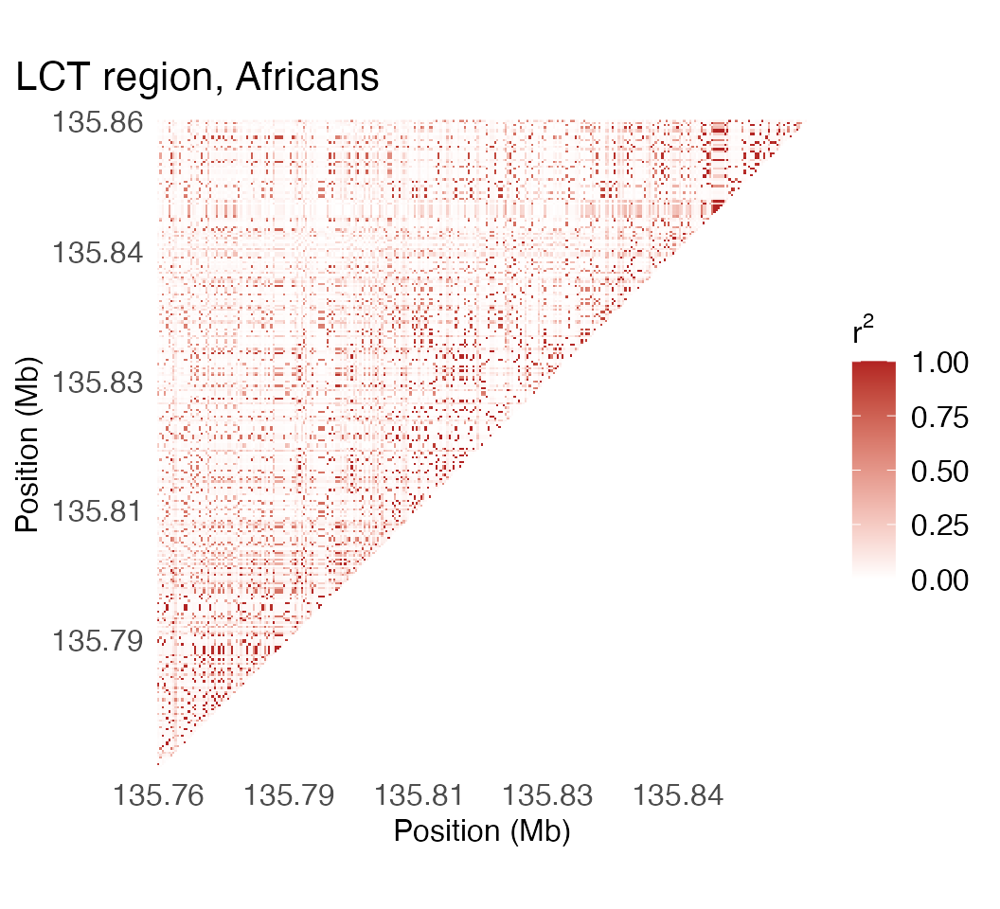
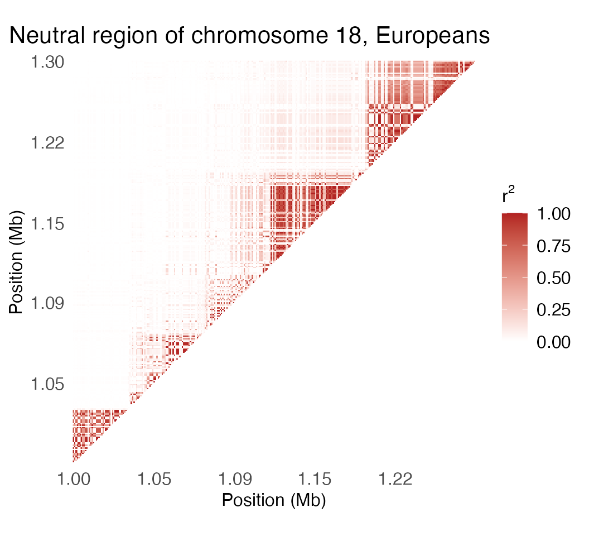

# Diversity and selection: heterozygosity, allele frequencies and LD

Two forces shape the genetic variation we see in human populations.
**Population history** (migrations, bottlenecks, growth and mixing)
affects the whole genome. **Natural selection** affects particular
genes, where a variant that helped people survive or reproduce in a
particular environment rose in frequency. This vignette shows how to see
both, by comparing a region with no gene under strong selection
(`example_neutral`, on chromosome 18) with the lactase gene
(`example_lct`).

``` r

library(snpscaper)
```

## Genetic diversity

### Heterozygosity

A person is **heterozygous** at a SNP if they carry two different
alleles. The more genetic diversity a population has, the more
heterozygous people it has.
[`calc_heterozygosity()`](https://jarekbryk.github.io/snpscaper/reference/calc_heterozygosity.md)
measures this in two ways: the observed proportion of heterozygous
genotypes, and the proportion expected from the population’s allele
frequencies (see
[`?calc_heterozygosity`](https://jarekbryk.github.io/snpscaper/reference/calc_heterozygosity.md)).

``` r

neutral <- filter_snps(example_neutral, min_maf = 0.01)
het <- calc_heterozygosity(neutral)
het[order(-het$expected), ]
#> # A tibble: 26 × 6
#>    pop   super_pop people  snps observed expected
#>    <chr> <chr>      <int> <int>    <dbl>    <dbl>
#>  1 MSL   AFR           85  1409    0.223    0.228
#>  2 YRI   AFR          108  1409    0.224    0.220
#>  3 ESN   AFR           99  1409    0.211    0.217
#>  4 ACB   AFR           96  1409    0.215    0.213
#>  5 GWD   AFR          113  1409    0.210    0.213
#>  6 LWK   AFR           99  1409    0.209    0.210
#>  7 ASW   AFR           61  1409    0.204    0.207
#>  8 STU   SAS          102  1409    0.152    0.162
#>  9 ITU   SAS          102  1409    0.156    0.159
#> 10 BEB   SAS           86  1409    0.154    0.156
#> # ℹ 16 more rows
```

``` r

plot_heterozygosity(het, title = "Diversity in a neutral region of chromosome 18")
```



African populations have the highest diversity. This is one of the most
consistent findings in human genetics, and is explained by the **serial
founder effect**: modern humans originated in Africa, and each time a
small group moved on to settle a new region, it carried only part of the
diversity of the group it came from. Diversity therefore tends to
decrease with distance from Africa.

### Selection reduces diversity

Now compare the lactase gene:

``` r

lct_het <- calc_heterozygosity(filter_snps(example_lct, min_maf = 0.01))
lct_het[order(-lct_het$expected), ]
#> # A tibble: 26 × 6
#>    pop   super_pop people  snps observed expected
#>    <chr> <chr>      <int> <int>    <dbl>    <dbl>
#>  1 ACB   AFR           96   417    0.203    0.200
#>  2 ESN   AFR           99   417    0.199    0.200
#>  3 ASW   AFR           61   417    0.203    0.197
#>  4 GWD   AFR          113   417    0.192    0.196
#>  5 LWK   AFR           99   417    0.186    0.195
#>  6 MSL   AFR           85   417    0.198    0.192
#>  7 YRI   AFR          108   417    0.176    0.192
#>  8 CHS   EAS          105   417    0.201    0.187
#>  9 CHB   EAS          103   417    0.180    0.187
#> 10 CDX   EAS           93   417    0.195    0.178
#> # ℹ 16 more rows
```

``` r

plot_heterozygosity(lct_het, title = "Diversity in the LCT region")
```



In the LCT region, European populations, especially CEU and GBR, have
much lower diversity than in the neutral region, and the lowest of all
26 populations. When the lactase persistence variant spread through
Northern Europe, the stretch of chromosome around it spread too,
replacing other versions of the region. Variation near a strongly
selected variant is “swept away”, so low local diversity in one
population is one of the signatures geneticists use to find genes under
selection.

A small region holds few independent pieces of evidence, so it is also
affected by chance and by the particular history of that stretch of DNA.
This is why conclusions about population history are based on many
regions across the genome, while unusual single regions point to
selection.

## Allele frequencies

### One SNP, many populations

[`calc_allele_freqs()`](https://jarekbryk.github.io/snpscaper/reference/calc_allele_freqs.md)
calculates the frequency of every SNP’s alternative allele in each
population.
[`plot_freqs()`](https://jarekbryk.github.io/snpscaper/reference/plot_freqs.md)
and
[`map_freqs()`](https://jarekbryk.github.io/snpscaper/reference/map_freqs.md)
show one SNP.

``` r

lct_freqs <- calc_allele_freqs(example_lct)
```

``` r

plot_freqs(lct_freqs, snp = "rs4988235")
```



``` r

map_freqs(lct_freqs, snp = "rs4988235")
```



rs4988235 is the main lactase persistence variant in Europeans. Most
mammals stop producing lactase, the enzyme that digests milk sugar,
after weaning. People who carry this variant keep producing it as
adults. The variant lies about 14 kb upstream of the LCT gene, inside
the neighbouring MCM6 gene, where it acts as an enhancer: a switch that
controls LCT activity. It is common in Northern Europe and rare in East
Asia. Lactase persistence evolved independently in parts of Africa and
the Middle East, through different variants that are rare in the 1000
Genomes populations.

On the map, some populations are drawn at their region of ancestral
origin, not where they were sampled. See
[`?pop_locations`](https://jarekbryk.github.io/snpscaper/reference/pop_locations.md).

### Other genes to try

The `teaching_genes` table lists genes with striking patterns, and
`teaching_snps` their key variants:

``` r

teaching_snps[, c("gene", "rsid", "note")]
#> # A tibble: 9 × 3
#>   gene    rsid      note                                                        
#>   <chr>   <chr>     <chr>                                                       
#> 1 LCT     rs4988235 European lactase persistence variant, known as -13910 C>T (…
#> 2 MC1R    rs1805007 R151C, red hair variant                                     
#> 3 MC1R    rs1805008 R160W, red hair variant                                     
#> 4 SLC24A5 rs1426654 Ala111Thr, light skin pigmentation                          
#> 5 EDAR    rs3827760 Val370Ala, hair thickness                                   
#> 6 ALDH2   rs671     Glu504Lys (ALDH2*2), alcohol flush                          
#> 7 ACKR1   rs2814778 Duffy-null promoter variant                                 
#> 8 HBB     rs334     Glu6Val, sickle cell (HbS)                                  
#> 9 CYP1A2  rs762551  CYP1A2*1F, caffeine metabolism
```

For example:

``` r

fetch_region("SLC24A5") |>
  calc_allele_freqs() |>
  map_freqs(snp = "rs1426654")

fetch_region("ACKR1") |>
  calc_allele_freqs() |>
  map_freqs(snp = "rs2814778")
```

### Finding the most differentiated SNPs

For a region without a known key variant, you can look for the SNPs
whose frequencies differ most between populations, using dplyr:

``` r

calc_allele_freqs(neutral, by = "super_pop") |>
  dplyr::group_by(id) |>
  dplyr::summarise(difference = max(alt_freq) - min(alt_freq)) |>
  dplyr::arrange(dplyr::desc(difference)) |>
  head()
#> # A tibble: 6 × 2
#>   id                difference
#>   <chr>                  <dbl>
#> 1 chr18:1080761:A:G      0.635
#> 2 chr18:1203096:T:C      0.629
#> 3 chr18:1028296:T:C      0.617
#> 4 chr18:1035816:A:C      0.616
#> 5 chr18:1036594:C:T      0.616
#> 6 chr18:1015611:G:A      0.613
```

## Linkage disequilibrium

### What LD is

Chromosomes are passed down in long pieces, broken up only occasionally
by recombination. SNPs close together therefore tend to be inherited
together: knowing someone’s allele at one SNP tells you something about
their allele at a nearby SNP. This is **linkage disequilibrium** (LD),
measured here as r², from 0 (no association) to 1 (complete
association).

[`calc_ld()`](https://jarekbryk.github.io/snpscaper/reference/calc_ld.md)
calculates r² between pairs of SNPs, and
[`plot_ld()`](https://jarekbryk.github.io/snpscaper/reference/plot_ld.md)
draws a heatmap. Rare SNPs give unreliable r² values, so we keep SNPs
with a minor allele frequency of at least 5% within the population we
look at, and we do not prune for LD (that would remove exactly the
pattern we want to see).

### LD reveals selection

When a favourable variant spreads quickly through a population, it
carries the surrounding stretch of DNA with it, before recombination has
had time to break it up. This **selective sweep** leaves an unusually
long block of high LD around the selected variant. Compare LD around LCT
in Europeans, where lactase persistence spread rapidly over the last few
thousand years, with LD in Africans:

``` r

example_lct |>
  keep_pops(super_pop = "EUR") |>
  filter_snps(min_maf = 0.05) |>
  calc_ld() |>
  plot_ld(title = "LCT region, Europeans")
```



``` r

example_lct |>
  keep_pops(super_pop = "AFR") |>
  filter_snps(min_maf = 0.05) |>
  calc_ld() |>
  plot_ld(title = "LCT region, Africans")
#> Using 300 evenly spaced SNPs out of 313 (see `max_snps`).
```



In Europeans, much of the region forms one large block of high LD (an
average r² of about 0.45 across all pairs of SNPs). In Africans, LD is
broken up into small patches (average r² about 0.1). Part of this
difference is general: African populations have older and larger
populations behind them, and so shorter LD everywhere in the genome. But
comparing with the neutral region, where the average r² in Europeans is
below 0.1, shows how unusual the LCT region is in Europeans:

``` r

example_neutral |>
  keep_pops(super_pop = "EUR") |>
  filter_snps(min_maf = 0.05) |>
  calc_ld() |>
  plot_ld(title = "Neutral region of chromosome 18, Europeans")
#> Using 300 evenly spaced SNPs out of 547 (see `max_snps`).
```


