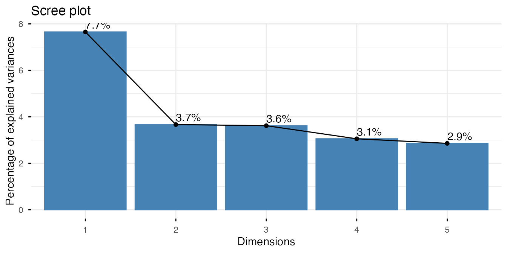
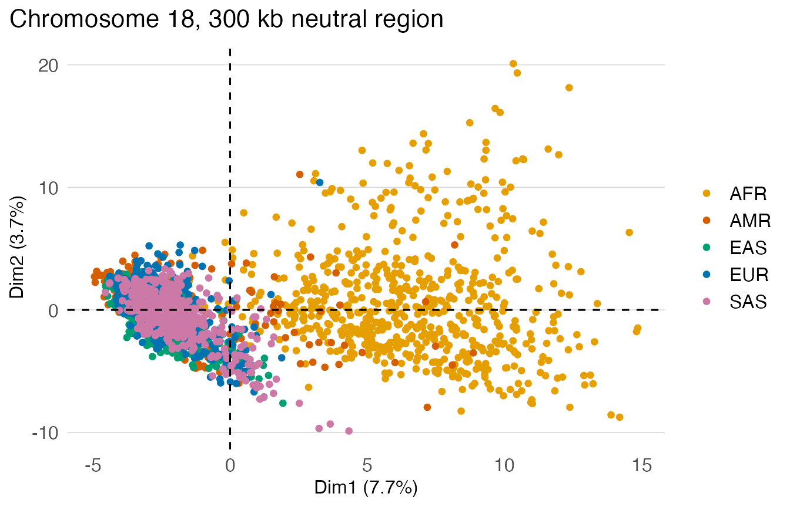
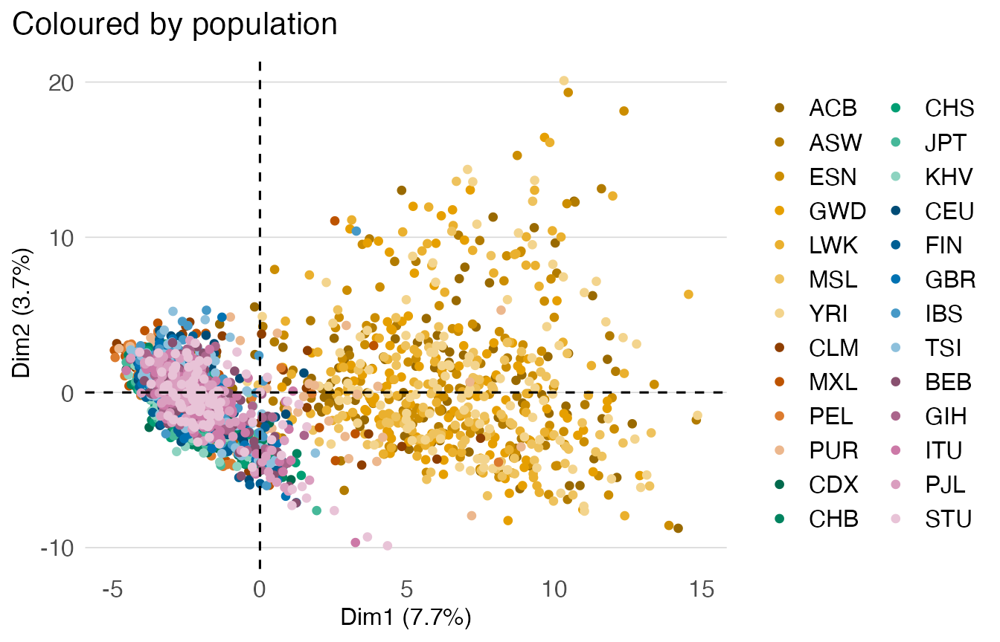
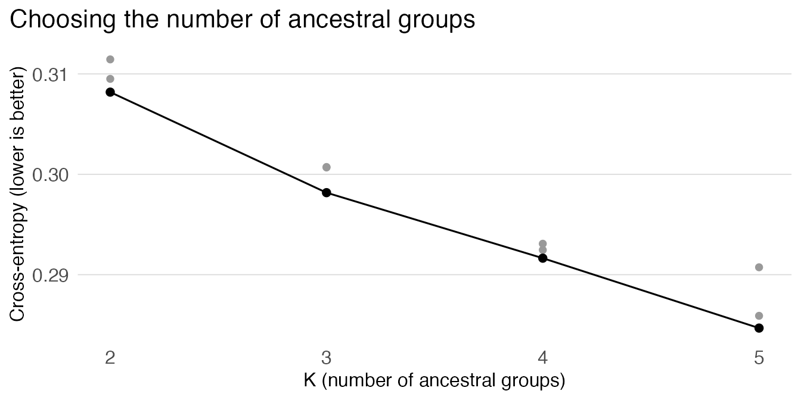
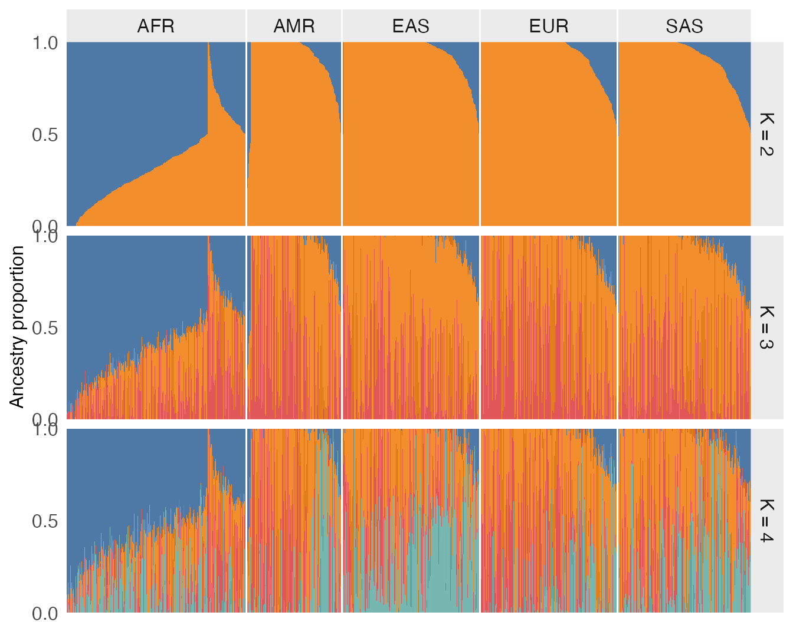
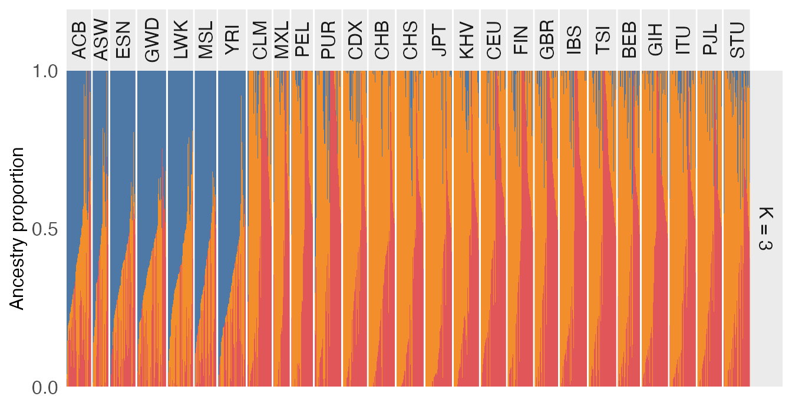
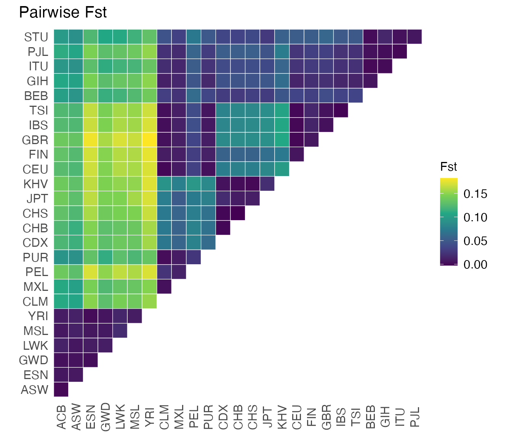

# Population structure: PCA, admixture and Fst

People from the same population share more of their genetic variation
with each other than with people from elsewhere, because they share more
recent ancestors. This vignette shows three ways of looking at that
**population structure**: principal component analysis (PCA), admixture
analysis, and Fst.

We use two regions that come with the package: `example_neutral`, 300 kb
of chromosome 18 with no gene known to be under strong selection, and
`example_lct`, the lactase gene, which has been under strong recent
selection in Europeans.

``` r

library(snpscaper)
library(FactoMineR)
#> Warning: package 'FactoMineR' was built under R version 4.6.1
library(factoextra)
#> Warning: package 'factoextra' was built under R version 4.6.1
#> Loading required package: ggplot2
#> Warning: package 'ggplot2' was built under R version 4.6.1
#> Welcome to factoextra!
#> Want to learn more? See two factoextra-related books at https://www.datanovia.com/library/principal-component-methods
```

## Preparing the data

PCA and admixture analysis assume that each SNP is an independent piece
of evidence. Nearby SNPs are often inherited together (they are in
linkage disequilibrium, LD), so we prune them first, keeping a set of
SNPs that are only weakly correlated. We also remove rare SNPs, which
carry little information about differences between populations.

``` r

neutral <- filter_snps(example_neutral, min_maf = 0.01, prune_ld = TRUE)
neutral
#> <snpscape> 2,504 people x 252 SNPs (GRCh38)
#> Regions:     chr18:1,000,000-1,300,000 
#> Populations: 26 populations in 5 super-populations
#> Steps:       fetched -> MAF >= 0.01 -> missing <= 0.05 -> LD pruned (r2 <= 0.2)
```

## Principal component analysis

### What PCA does

Each person is described by their genotypes at hundreds of SNPs, far too
many dimensions to look at directly. PCA finds new axes, the **principal
components**, that capture as much of the variation between people as
possible: the first component captures the most, the second the most of
what remains, and so on. Plotting people on the first two components
gives a “map” in which people with similar genotypes are close together.

snpscaper does not have its own PCA function. Instead,
[`as_pca_table()`](https://jarekbryk.github.io/snpscaper/reference/as_pca_table.md)
prepares the data for the FactoMineR and factoextra packages, which you
may already know from other courses. The first three columns of the
table are labels (population, super-population and sex), which we mark
as “supplementary” with `quali.sup = 1:3` so that they are carried along
but not used in the calculation.

``` r

pca_table <- as_pca_table(neutral)
pca_table[1:4, 1:6]
#>         pop super_pop    sex chr18:1005430:C:T chr18:1005828:A:C
#> HG01879 ACB       AFR   male                 0                 2
#> HG01880 ACB       AFR female                 0                 2
#> HG01882 ACB       AFR   male                 0                 2
#> HG01883 ACB       AFR female                 0                 2
#>         chr18:1005961:C:T
#> HG01879                 0
#> HG01880                 0
#> HG01882                 0
#> HG01883                 0

pca <- PCA(pca_table, quali.sup = 1:3, graph = FALSE)
```

### How much variation does each component capture?

``` r

fviz_eig(pca, addlabels = TRUE)
#> Warning: This FactoMineR PCA result contains only 5 eigenvalues and does not
#> include the complete spectrum. Refit the PCA with a larger `ncp` before drawing
#> a complete scree plot.
```



With genetic data, each component usually captures only a few per cent
of the variation. That is normal: most genetic variation is shared by
all populations, and only a small part differs between them.

### Plotting people

``` r

fviz_pca_ind(
  pca,
  habillage = "super_pop",
  palette = unname(superpop_colours),
  geom = "point",
  pointshape = 19,
  mean.point = FALSE,
  title = "Chromosome 18, 300 kb neutral region"
) +
  theme_jb()
```



Even in this small region, the first component separates African from
non-African people. This reflects human history: all non-African
populations descend from a relatively small group of people who left
Africa around 50,000 to 70,000 years ago, carrying only part of the
genetic diversity that existed in Africa. African people are also spread
much more widely along the second component than everyone else: a sign
of their greater genetic diversity. People with recent mixed African and
European ancestry (from ASW and ACB) lie between the two clusters.

`habillage` chooses the column that sets the colours, and `palette`
gives the colours. snpscaper’s `superpop_colours` and `pop_colours` make
sure the same population always has the same colour. To colour by
population:

``` r

pop_labels <- levels(pca_table$pop)
fviz_pca_ind(
  pca,
  habillage = "pop",
  palette = unname(pop_colours[pop_labels]),
  geom = "point",
  pointshape = 19,
  mean.point = FALSE,
  title = "Coloured by population"
) +
  theme_jb()
```



### Things to keep in mind

- PCA is driven by the people included. Adding or removing populations
  changes the components. Try
  [`keep_pops()`](https://jarekbryk.github.io/snpscaper/reference/keep_pops.md)
  with different populations.
- A small region contains far less information than the whole genome, so
  clusters overlap much more than in published genome-wide PCA plots.
- The components have no fixed meaning. The direction of an axis can
  flip between analyses.

## Admixture analysis

### What admixture analysis does

Admixture analysis assumes that people descend from *K* ancestral
groups, and estimates what proportion of each person’s genome comes from
each group. snpscaper uses the sNMF method from the LEA package, which
runs inside R.

The ancestral groups are statistical constructs, not real historical
populations. The method finds *K* groups whether or not they exist, and
the results depend on which populations are included and how many people
come from each.

``` r

adm <- run_admixture(neutral, k = 2:5, reps = 3)
#> Running admixture for K = 2, 3, 4, and 5 (3 runs each, 252 SNPs)...
```

### Choosing K

For each *K*, sNMF hides some genotypes, then checks how well the model
predicts them. This **cross-entropy** is lower when the model fits
better. A sensible *K* is where the curve flattens out or reaches its
lowest point.

``` r

plot_cross_entropy(adm)
```



### Ancestry proportions

Each person is a thin vertical bar, divided into the proportions of
their genome assigned to each ancestral group:

``` r

plot_admixture(adm, k = 2:4)
```



``` r

plot_admixture(adm, k = 3, group = "pop")
```



The colours stand for ancestral groups, not populations, which is why
they differ from the colours of the PCA plots. At *K* = 2 the analysis
separates African from non-African ancestry, mirroring the first
principal component. At higher *K*, nearly everyone appears as a
mixture: a 300 kb region simply does not contain enough information to
separate continents cleanly. Published admixture analyses use hundreds
of thousands of SNPs from across the genome. Try a larger region (up to
a few megabases) to see the groups become sharper.

To work with the numbers yourself, use
[`get_ancestry()`](https://jarekbryk.github.io/snpscaper/reference/get_ancestry.md):

``` r

get_ancestry(adm, k = 3, wide = TRUE)
#> # A tibble: 2,504 x 7
#>    sample_id pop   super_pop     k   group_1   group_2   group_3
#>    <chr>     <chr> <chr>     <int>     <dbl>     <dbl>     <dbl>
#>  1 HG01879   ACB   AFR           3 0.402     0.0001000 0.597    
#>  2 HG01880   ACB   AFR           3 0.0429    0.808     0.150    
#>  3 HG01882   ACB   AFR           3 0.391     0.343     0.267    
#>  4 HG01883   ACB   AFR           3 0.498     0.218     0.284    
#>  5 HG01885   ACB   AFR           3 0.439     0.414     0.147    
#>  6 HG01886   ACB   AFR           3 0.490     0.410     0.0999   
#>  7 HG01889   ACB   AFR           3 0.440     0.560     0.0001000
#>  8 HG01890   ACB   AFR           3 0.709     0.123     0.168    
#>  9 HG01894   ACB   AFR           3 0.443     0.557     0.0001000
#> 10 HG01896   ACB   AFR           3 0.0001000 0.538     0.462    
#> # i 2,494 more rows
```

## Fst

### What Fst measures

Fst measures how much of the genetic variation lies *between*
populations rather than *within* them: 0 when two populations have
identical allele frequencies, 1 when they share no alleles at all.
snpscaper uses Hudson’s estimator, combined across SNPs (see
[`?calc_fst`](https://jarekbryk.github.io/snpscaper/reference/calc_fst.md)).

Fst does not need LD pruning, so we use all common SNPs:

``` r

neutral_common <- filter_snps(example_neutral, min_maf = 0.01)
calc_fst(neutral_common, by = "super_pop")
#> # A tibble: 10 x 3
#>    group1 group2     fst
#>    <chr>  <chr>    <dbl>
#>  1 AFR    AMR    0.127  
#>  2 AFR    EAS    0.139  
#>  3 AFR    EUR    0.149  
#>  4 AFR    SAS    0.117  
#>  5 AMR    EAS    0.0662 
#>  6 AMR    EUR    0.00716
#>  7 AMR    SAS    0.0281 
#>  8 EAS    EUR    0.0787 
#>  9 EAS    SAS    0.0401 
#> 10 EUR    SAS    0.0278
```

Typical genome-wide values are around 0.1 to 0.15 between Africa and
other continents, and around 0.05 to 0.1 between other continents. In
other words, about 85 to 90% of human genetic variation is found within
continental groups. Between populations of the same continent, Fst is
usually around 0.01 or less:

``` r

calc_fst(neutral_common, by = "pop") |>
  plot_fst()
```



### Genes under selection

Natural selection can push allele frequencies apart in some populations,
giving much higher Fst in a single gene than in the genome as a whole.
Compare the LCT region with the neutral region:

``` r

lct_common <- filter_snps(example_lct, min_maf = 0.01)
calc_fst(lct_common, by = "super_pop")
#> # A tibble: 10 x 3
#>    group1 group2    fst
#>    <chr>  <chr>   <dbl>
#>  1 AFR    AMR    0.0880
#>  2 AFR    EAS    0.0797
#>  3 AFR    EUR    0.173 
#>  4 AFR    SAS    0.0692
#>  5 AMR    EAS    0.0243
#>  6 AMR    EUR    0.0372
#>  7 AMR    SAS    0.0116
#>  8 EAS    EUR    0.0686
#>  9 EAS    SAS    0.0388
#> 10 EUR    SAS    0.0824
```

Some comparisons involving Europeans are clearly higher in the LCT
region than in the neutral region (Europeans against South Asians,
Admixed Americans and Africans), because the lactase persistence allele
and the stretch of DNA around it rose in frequency in Europe. Others,
such as Europeans against East Asians, are not. Fst here is averaged
over all common SNPs in a 100 kb region, so a single selected variant
only shifts it so far; the allele frequencies of the variant itself (see
the [diversity and
selection](https://jarekbryk.github.io/snpscaper/articles/diversity-and-selection.md)
vignette) show the effect much more clearly. Fetch `SLC24A5` or `ACKR1`
to see regions where Fst is far above the genome-wide level.
