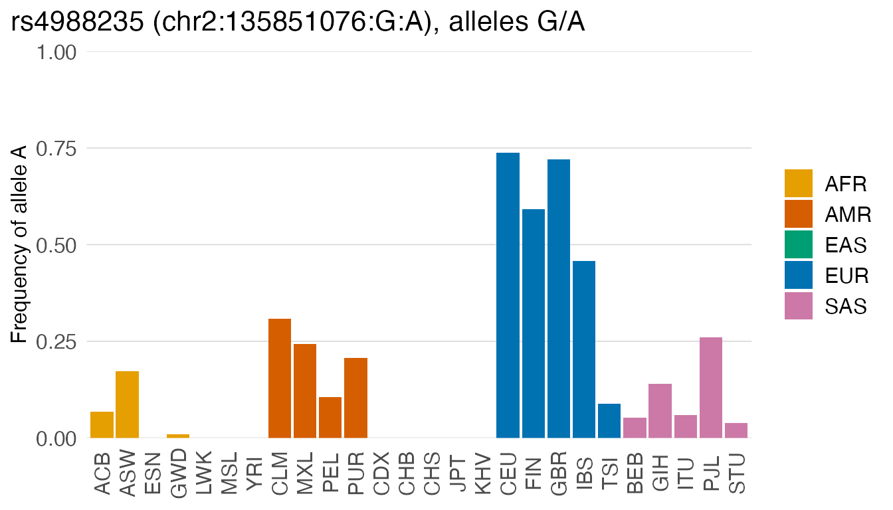

# Getting started with snpscaper

snpscaper lets you explore how human genetic variation is distributed
within and between populations around the world, using real genome data
from the 1000 Genomes Project. You choose a gene or a region of the
genome; snpscaper fetches the data and helps you analyse and plot it,
all inside R.

This vignette introduces the key ideas and the basic workflow. Other
vignettes cover [population
structure](https://jarekbryk.github.io/snpscaper/articles/population-structure.md)
(PCA, admixture and Fst), [diversity and
selection](https://jarekbryk.github.io/snpscaper/articles/diversity-and-selection.md)
(heterozygosity, allele frequencies and linkage disequilibrium), and
[making
reports](https://jarekbryk.github.io/snpscaper/articles/reports.md).

## Key ideas

### Genomes, SNPs and genotypes

The human genome is about 3 billion DNA letters long, spread over 22
pairs of autosomes plus the sex chromosomes. Any two people’s genomes
are about 99.9% identical. Most of the differences are **SNPs** (single
nucleotide polymorphisms): positions where some people carry one letter,
say `G`, and others carry another, say `A`. The two versions are called
**alleles**.

Because we inherit one copy of each autosome from each parent, everyone
carries two alleles at every SNP. At a SNP with alleles `G` and `A`, a
person can be `GG`, `GA` or `AA`. snpscaper records this **genotype** as
the number of copies of one of the alleles (the “alternative” allele,
here `A`): 0, 1 or 2.

### Reference and alternative alleles

Every SNP has a **reference** allele, the letter found in the human
reference genome, and an **alternative** allele. The reference genome
was assembled mostly from a few individuals, so the reference allele is
simply a convention: it is not necessarily the ancestral allele, nor the
more common one. Always check which allele a frequency refers to.

### Genome positions and GRCh38

Positions in the genome are given as a chromosome and a number of DNA
letters from its start, for example `chr2:135,851,076`. These
coordinates depend on the version of the reference genome. snpscaper
uses the current version, **GRCh38** (also called hg38), as do Ensembl
and the UCSC Genome Browser by default.

### The 1000 Genomes Project

The [1000 Genomes Project](https://www.internationalgenome.org)
sequenced the genomes of people from 26 populations, grouped into five
continental **super-populations**. snpscaper uses the 2,504 unrelated
people from the project, whose genomes were later re-sequenced at high
coverage by the New York Genome Center.

``` r

library(snpscaper)

table(samples_1kg$super_pop)
#> 
#> AFR AMR EAS EUR SAS 
#> 661 347 504 503 489
head(samples_1kg)
#>   sample_id pop super_pop    sex                      pop_name super_pop_name
#> 1   HG01879 ACB       AFR   male African Caribbean in Barbados        African
#> 2   HG01880 ACB       AFR female African Caribbean in Barbados        African
#> 3   HG01882 ACB       AFR   male African Caribbean in Barbados        African
#> 4   HG01883 ACB       AFR female African Caribbean in Barbados        African
#> 5   HG01885 ACB       AFR   male African Caribbean in Barbados        African
#> 6   HG01886 ACB       AFR female African Caribbean in Barbados        African
```

| Code | Super-population | Populations                       |
|------|------------------|-----------------------------------|
| AFR  | African          | ACB, ASW, ESN, GWD, LWK, MSL, YRI |
| AMR  | Admixed American | CLM, MXL, PEL, PUR                |
| EAS  | East Asian       | CDX, CHB, CHS, JPT, KHV           |
| EUR  | European         | CEU, FIN, GBR, IBS, TSI           |
| SAS  | South Asian      | BEB, GIH, ITU, PJL, STU           |

A few things are worth knowing about these populations. “Admixed
American” populations have recent ancestry from several continents
(Indigenous American, European and African). ASW (African Ancestry in
Southwest US) and ACB (African Caribbean in Barbados) also have mixed
recent ancestry. Some populations were sampled away from their region of
origin, for example CEU (Utah residents with Northern and Western
European ancestry) and GIH (Gujarati Indians in Houston).

### VCF files

Genotype data are usually stored in **VCF** (variant call format) files:
large text files with one line per variant and one column per person.
The 1000 Genomes Project publishes one compressed VCF file per
chromosome, each tens of gigabytes. snpscaper never downloads a whole
file. Each file has a small **index** that records where each part of
the chromosome is stored, so snpscaper reads only the part you ask for.

## The basic workflow

### 1. Fetch a region

[`fetch_region()`](https://jarekbryk.github.io/snpscaper/reference/fetch_region.md)
takes gene symbols or coordinates:

``` r

lct <- fetch_region("LCT")
mc1r <- fetch_region("MC1R", flank = 10000) # 10 kb either side of the gene
neutral <- fetch_region("chr18:1,000,000-1,300,000")
```

For genes, a flanking region (25 kb by default) is added on each side,
because variants that control a gene’s activity often lie just outside
it. The main lactase persistence variant, for example, sits 14 kb
upstream of the LCT gene.

The first fetch needs an internet connection and takes from a few
seconds to a minute. The data are then saved on your computer, so
fetching the same region again is instant and works offline (see
[`?clear_cache`](https://jarekbryk.github.io/snpscaper/reference/clear_cache.md)).

This vignette uses `example_lct`, a copy of `fetch_region("LCT")` that
comes with the package:

``` r

lct <- example_lct
lct
#> <snpscape> 2,504 people x 1,922 SNPs (GRCh38)
#> Regions:     LCT (chr2:135,762,850-135,862,184) 
#> Populations: 26 populations in 5 super-populations
#> Steps:       fetched
```

The result is a `snpscape` object. It holds the genotypes (a table with
one row per person and one column per SNP), a description of each SNP, a
description of each person, and a record of where the data came from and
what has been done to them.

``` r

lct$genotypes[1:5, 1:4]
#>         chr2:135762991:A:T chr2:135763024:T:C chr2:135763080:C:T
#> HG01879                  0                  0                  0
#> HG01880                  0                  0                  0
#> HG01882                  0                  0                  0
#> HG01883                  0                  0                  0
#> HG01885                  0                  0                  0
#>         chr2:135763134:C:T
#> HG01879                  0
#> HG01880                  0
#> HG01882                  0
#> HG01883                  0
#> HG01885                  0
head(lct$variants)
#>                   id chrom       pos ref alt region rsid
#> 1 chr2:135762991:A:T  chr2 135762991   A   T    LCT <NA>
#> 2 chr2:135763024:T:C  chr2 135763024   T   C    LCT <NA>
#> 3 chr2:135763080:C:T  chr2 135763080   C   T    LCT <NA>
#> 4 chr2:135763134:C:T  chr2 135763134   C   T    LCT <NA>
#> 5 chr2:135763290:C:G  chr2 135763290   C   G    LCT <NA>
#> 6 chr2:135763397:G:A  chr2 135763397   G   A    LCT <NA>
```

### 2. Choose genes to explore

The package includes a set of genes that make good teaching examples,
with a short description of each and one or two key SNPs:

``` r

teaching_genes[, c("gene", "chrom", "description")]
#>      gene chrom
#> 1     LCT  chr2
#> 2    MC1R chr16
#> 3 SLC24A5 chr15
#> 4    EDAR  chr2
#> 5   ALDH2 chr12
#> 6   ACKR1  chr1
#> 7     HBB chr11
#> 8  CYP1A2 chr15
#> 9     HTT  chr4
#>                                                                                                                                       description
#> 1                                    Lactase, the enzyme that digests the milk sugar lactose. In most mammals its production stops after weaning.
#> 2              Melanocortin 1 receptor, which controls the switch between dark (eumelanin) and red/yellow (pheomelanin) pigment in skin and hair.
#> 3                                             A potassium-dependent sodium/calcium exchanger found in melanosomes, involved in skin pigmentation.
#> 4                                                          Ectodysplasin A receptor, involved in the development of hair, teeth and sweat glands.
#> 5                      Aldehyde dehydrogenase 2, a mitochondrial enzyme that breaks down acetaldehyde produced when the body metabolises alcohol.
#> 6 Atypical chemokine receptor 1 (Duffy antigen), a red blood cell surface protein that the malaria parasite Plasmodium vivax uses to enter cells.
#> 7                                                               Haemoglobin subunit beta, part of the oxygen-carrying protein in red blood cells.
#> 8                                                               Cytochrome P450 1A2, a liver enzyme that metabolises caffeine and many medicines.
#> 9                 Huntingtin, a large protein needed for nerve cell function. Expansions of a CAG repeat in this gene cause Huntington's disease.
teaching_snps[, c("gene", "rsid", "note")]
#>      gene      rsid
#> 1     LCT rs4988235
#> 2    MC1R rs1805007
#> 3    MC1R rs1805008
#> 4 SLC24A5 rs1426654
#> 5    EDAR rs3827760
#> 6   ALDH2     rs671
#> 7   ACKR1 rs2814778
#> 8     HBB     rs334
#> 9  CYP1A2  rs762551
#>                                                                                                                                                                                   note
#> 1 European lactase persistence variant, known as -13910 C>T (T = persistence). LCT lies on the reverse strand, so on the genome's forward strand used here it is G>A (A = persistence)
#> 2                                                                                                                                                              R151C, red hair variant
#> 3                                                                                                                                                              R160W, red hair variant
#> 4                                                                                                                                                   Ala111Thr, light skin pigmentation
#> 5                                                                                                                                                            Val370Ala, hair thickness
#> 6                                                                                                                                                   Glu504Lys (ALDH2*2), alcohol flush
#> 7                                                                                                                                                          Duffy-null promoter variant
#> 8                                                                                                                                                           Glu6Val, sickle cell (HbS)
#> 9                                                                                                                                                       CYP1A2*1F, caffeine metabolism
```

Any other gene can be fetched by its official symbol. Use
[`find_gene()`](https://jarekbryk.github.io/snpscaper/reference/find_gene.md)
to check where it is, and
[`find_snp()`](https://jarekbryk.github.io/snpscaper/reference/find_snp.md)
to look up an rs number.

### 3. Filter SNPs

Most SNPs in the genome are very rare, and most analyses work better on
a cleaned-up set.
[`filter_snps()`](https://jarekbryk.github.io/snpscaper/reference/filter_snps.md)
removes rare SNPs and SNPs with many missing genotypes, and can also
remove SNPs that are strongly correlated with their neighbours (LD
pruning; see
[`?filter_snps`](https://jarekbryk.github.io/snpscaper/reference/filter_snps.md)
for why this matters).

``` r

lct_common <- filter_snps(lct, min_maf = 0.01)
lct_pruned <- filter_snps(lct, min_maf = 0.01, prune_ld = TRUE)
lct_pruned
#> <snpscape> 2,504 people x 61 SNPs (GRCh38)
#> Regions:     LCT (chr2:135,762,850-135,862,184) 
#> Populations: 26 populations in 5 super-populations
#> Steps:       fetched -> MAF >= 0.01 -> missing <= 0.05 -> LD pruned (r2 <= 0.2)
```

Of the 1,922 SNPs in the LCT region, only about one in five has a minor
allele frequency of 1% or more, and LD pruning keeps only a small
fraction of those. The LCT region has unusually strong LD because of
recent selection, as the [diversity and
selection](https://jarekbryk.github.io/snpscaper/articles/diversity-and-selection.md)
vignette explains.

### 4. Choose populations

[`keep_pops()`](https://jarekbryk.github.io/snpscaper/reference/keep_pops.md)
narrows the data to the populations you want to compare:

``` r

lct_subset <- keep_pops(lct_common, pop = c("YRI", "GBR", "FIN", "CHB", "PJL"))
summary(lct_subset)
#> <snpscape> 497 people x 417 SNPs (GRCh38)
#> Regions:     LCT (chr2:135,762,850-135,862,184) 
#> Populations: 5 populations in 4 super-populations
#> Steps:       fetched -> MAF >= 0.01 -> missing <= 0.05 -> kept YRI, GBR, FIN, CHB, PJL 
#> 
#> People per population:
#> # A tibble: 5 x 4
#>   super_pop pop   pop_name                          people
#>   <chr>     <chr> <chr>                              <int>
#> 1 AFR       YRI   Yoruba in Ibadan, Nigeria            108
#> 2 EAS       CHB   Han Chinese in Beijing, China        103
#> 3 EUR       FIN   Finnish in Finland                    99
#> 4 EUR       GBR   British from England and Scotland     91
#> 5 SAS       PJL   Punjabi in Lahore, Pakistan           96
#> 
#> Processing steps:
#> # A tibble: 4 x 3
#>   step                         people  snps
#>   <chr>                         <int> <int>
#> 1 fetched                        2504  1922
#> 2 MAF >= 0.01                    2504   417
#> 3 missing <= 0.05                2504   417
#> 4 kept YRI, GBR, FIN, CHB, PJL    497   417
```

[`summary()`](https://rdrr.io/r/base/summary.html) lists the people per
population and every processing step.

### 5. Analyse and plot

From here, every analysis follows the same pattern: a `calc_*()`
function calculates the numbers as a table, and a `plot_*()` function
draws them. For example, the frequency of the lactase persistence allele
in each population:

``` r

freqs <- calc_allele_freqs(lct)
freqs[freqs$rsid %in% "rs4988235", c("pop", "super_pop", "ref", "alt", "alt_freq")]
#> # A tibble: 26 x 5
#>    pop   super_pop ref   alt   alt_freq
#>    <chr> <chr>     <chr> <chr>    <dbl>
#>  1 ACB   AFR       G     A       0.0677
#>  2 ASW   AFR       G     A       0.172 
#>  3 BEB   SAS       G     A       0.0523
#>  4 CDX   EAS       G     A       0     
#>  5 CEU   EUR       G     A       0.737 
#>  6 CHB   EAS       G     A       0     
#>  7 CHS   EAS       G     A       0     
#>  8 CLM   AMR       G     A       0.309 
#>  9 ESN   AFR       G     A       0     
#> 10 FIN   EUR       G     A       0.591 
#> # i 16 more rows
```

``` r

plot_freqs(freqs, snp = "rs4988235")
```



The persistence allele (`A` on the genome’s forward strand; it is
usually described as `T`, because LCT is read from the opposite strand)
is common in Northern Europe, present at lower frequencies in South Asia
and in admixed populations, and absent from the East Asian samples.

All plots are ordinary ggplot2 objects, so you can change them in the
usual way, for example by adding `+ ggplot2::labs(title = "My title")`.

## Where next

- [Population
  structure](https://jarekbryk.github.io/snpscaper/articles/population-structure.md):
  PCA, admixture and Fst.
- [Diversity and
  selection](https://jarekbryk.github.io/snpscaper/articles/diversity-and-selection.md):
  heterozygosity, allele frequencies on maps, and linkage
  disequilibrium.
- [Making
  reports](https://jarekbryk.github.io/snpscaper/articles/reports.md):
  ready-made HTML handouts for any region.
